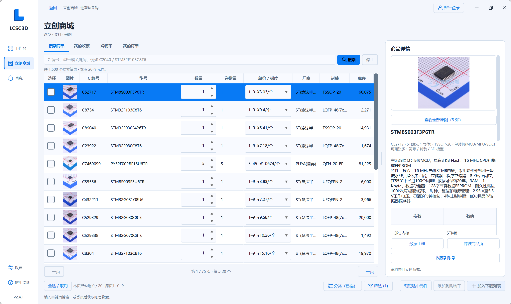
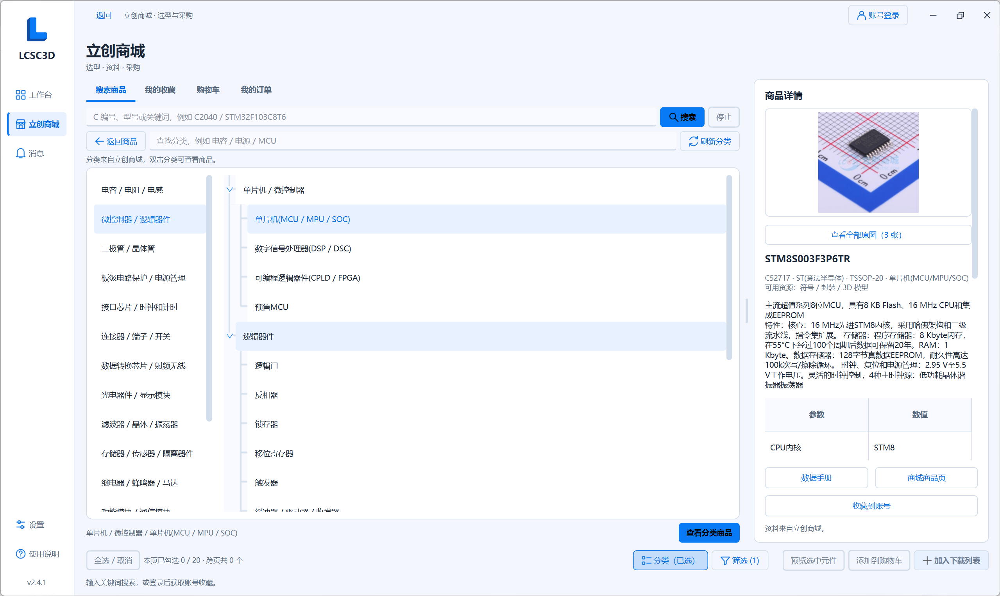
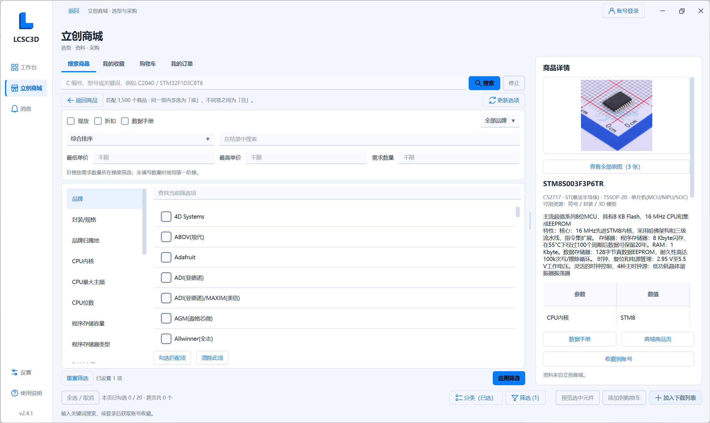
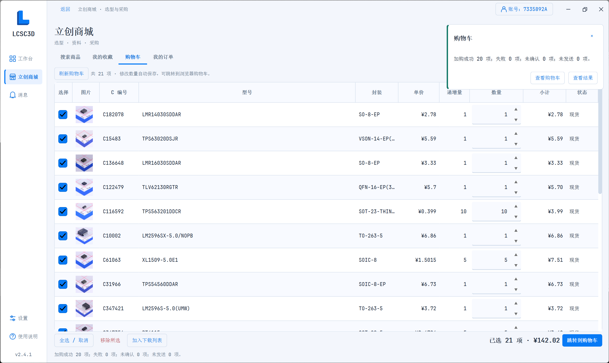
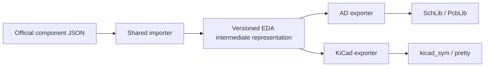

<p align="center">
  <picture>
    <source media="(prefers-color-scheme: dark)" srcset="app/assets/branding/lcsc3d-logo-dark.svg">
    
  </picture>
</p>

[简体中文](README.md) | **English**

# LCSC3D: Embedded 3D Models and AD / KiCad Library Export

[](https://github.com/Travelerrrrrr/LCSC3D/releases/latest)
[](https://github.com/Travelerrrrrr/LCSC3D/actions/workflows/windows.yml)
[](https://github.com/Travelerrrrrr/LCSC3D/releases/latest)
[](LICENSE)
[](docs/sponsorship.md)

**Find parts through LCSC search, mainland account favorites or C-numbers, and export AD / KiCad symbols and footprints with attached 3D models in batches. Download original STEP / OBJ files separately when needed.**

LCSC3D is a portable Windows tool for hardware development, PCB design and mechanical fit checks. Download and run `LCSC3D.exe`; no Python installation is required. Generating libraries does not require the target EDA software to be installed.

**3D models are attached to footprints by default.** AD PcbLib and KiCad 9/10 footprints embed STEP models, keeping the model with the library file. KiCad 8 uses portable external models. The original STEP size is preserved and the source placement anchor is converted before applying the official pose.

**[Download for Windows](https://github.com/Travelerrrrrr/LCSC3D/releases/latest/download/LCSC3D.exe)** · [Full source package](https://github.com/Travelerrrrrr/LCSC3D/releases/latest/download/LCSC3D.zip) · [User guide (Chinese)](app/README.md) · [Report an issue](https://github.com/Travelerrrrrr/LCSC3D/issues)


## Quick start

1. Download `LCSC3D.exe` from [Releases](https://github.com/Travelerrrrrr/LCSC3D/releases/latest) and run it on Windows 10/11 x64.
2. For English, open **设置 → 外观 → 语言 / Language**, select **English**, and click **保存 / Save**. Search through **LCSC International** and add checked products to the download list, or enter `C2040, C20197, C456013` and click **Load list**.
3. Click a part to preview it, check the parts to export, and choose an output folder.
4. Choose **Altium Designer / KiCad** under **Export to** and select model and library formats. Enable **Lib → Merge** to combine libraries and set their names independently.
5. Click **Download**, then **Part folder**. Open SchLib / PcbLib in AD, or add the symbol file and footprint directory through KiCad's library managers.

**Merging again uses the current selection.** Normal and merged AD / KiCad exports replace same-name libraries after successful generation. KiCad replaces the entire same-name `.pretty` directory, removing old members. Include every part you want to retain. AD's **Append** mode adds parts to existing libraries; KiCad append is not currently available.

## Mainland storefront: selection, information and purchasing

The native storefront brings **Search products, My favorites, Cart and My orders** into one workspace, connecting part selection and purchasing with library export.

| Page | What it provides |
| --- | --- |
| Search products | Search by C-number, MPN or keyword, browse official categories, and filter by brand, package, component parameters, price and stock. View photos, specifications, datasheets and price tiers; keep checked parts across pages. |
| My favorites | Read your mainland account favorites, find saved parts, and add or remove favorites. Add checked parts to the download list or cart. |
| Cart | View photos, quantities, unit prices, subtotals and stock status. Edit quantities directly with automatic saving, remove items, or add parts to the download list. Open the official cart in your system browser to confirm the order and pay. |
| My orders | Search orders by keyword and status. Open an order within the same table area to view purchased parts and other items, photos, quantities, prices and amounts. Add checked parts to the download list and return without losing your list position. Full order details can be opened in the external browser. |

Search and favorites support inline purchase quantities with each part's minimum and increment. Search prices follow the entered quantity, with all price tiers still available to inspect. A row's context menu offers **Add to download list, Add to favorites and Add to cart**; batch cart additions use each row's quantity.

Add checked parts from search, favorites, cart or orders to the download list. C-numbers are deduplicated before preview and AD / KiCad or model export. Drag column borders to resize and double-click product photos to view originals.

Public search requires no login; favorites, cart and orders use a mainland LCSC account. These account purchasing pages are available in Chinese mode. English mode uses LCSC International search, with international account management on LCSC.com.

User-provided storefront screenshots. Click an image to view the original.

**Product search, inline quantities and price tiers**

<a href="docs/images/storefront/search.png"></a>

**Official category browser**

<a href="docs/images/storefront/categories.png"></a>

**Product filters and component parameters**

<a href="docs/images/storefront/filters.png"></a>

**Native cart, quantity increments and batch results**

<a href="docs/images/storefront/cart.png"></a>

## Embedded 3D models

Select AD **PcbLib** or KiCad **Footprints** and leave **Attach 3D models to footprints** enabled. LCSC3D fetches the required official STEP and writes its placement into the footprint. **You do not need to select standalone STEP downloads or attach each model manually in the EDA application.**

| Target | Model storage | Moving the library |
| --- | --- | --- |
| Altium Designer | STEP embedded in `.PcbLib` | The model stays inside the footprint library |
| KiCad 9 / 10 | STEP embedded in `.kicad_mod` | The model stays with the footprint file; keep the `.pretty` library structure |
| KiCad 8 | External STEP in `.pretty/LCSC3D.3dshapes/` | Keep the entire `.pretty` folder and model directory |

These user-provided AD and KiCad screenshots show the exported Type-C models. Click an image to view the original.

| AD embedded model example 1 | AD embedded model example 2 |
| --- | --- |
| <a href="docs/images/2.4.0-release/ad-embedded-typec-user.png"></a> | <a href="docs/images/2.4.0-release/ad-embedded-typec-side-user.png"></a> |

| KiCad PCB 3D view | KiCad underside and pads |
| --- | --- |
| <a href="docs/images/2.4.0-release/kicad-embedded-typec-top-user.png"></a> | <a href="docs/images/2.4.0-release/kicad-embedded-typec-bottom-user.png"></a> |

A missing or failed 3D model does not discard an available 2D footprint. **A storefront product does not guarantee that official symbol, footprint or model data is available.** See the [user guide (Chinese)](app/README.md) and [placement details (Chinese)](docs/3D模型放置.md).

## Symbol and footprint export

| Feature | Altium Designer | KiCad 8+ |
| --- | --- | --- |
| Formats | Native `.SchLib` / `.PcbLib` | `.kicad_sym` / `.kicad_mod` files in `.pretty` |
| Individual and merged libraries | Independent symbol/footprint merging and names, optional per-part copies | Same workflow, with shared-footprint reuse |
| Pin electrical types | All exported pins are Passive | Source types by default or a uniform override; unsupported types become Unspecified |
| Symbol style | JLC / AD, selected in the preview and applied to export | KiCad style; square rectangles with solid body-background fill |
| Footprint geometry | Pads, holes, slots, copper regions, graphics and native vias | Pads, holes, slots, copper regions and graphics; vias retained as unnumbered plated through-holes |
| Append and projects | Append to libraries, customize project folders/names and import into `.PrjPcb` | Append and automatic project registration are not yet supported |

In KiCad, **use the exported footprint library name as its nickname**, such as `LCSC3D`, so symbol footprint references resolve. Footprint vias retain their positions, drills and copper rings; confirm their net assignment in the PCB. Conversion approximations appear in export results.

Both targets support multi-unit symbols, string pin numbers and common surface-mount / through-hole footprints, with available 3D models attached by default. AD IntLib generation is not supported.

Detailed operations are in the [user guide (Chinese)](app/README.md).

## KiCad export examples

These user-provided KiCad screenshots show exported symbols and footprints. Click any image to view the original.

| IC symbol | MOSFET symbol |
| --- | --- |
| <a href="docs/images/2.3.0-release/kicad-symbol-ic-user.png"></a> | <a href="docs/images/2.3.0-release/kicad-symbol-mosfet-user.png"></a> |

| Footprint with vias | Custom pad footprint |
| --- | --- |
| <a href="docs/images/2.3.0-release/kicad-footprint-vias-user.png"></a> | <a href="docs/images/2.3.0-release/kicad-footprint-custom-pads-user.png"></a> |

**Footprint with a thermal pad**

<a href="docs/images/2.3.0-release/kicad-footprint-thermal-pad-user.png"></a>

## AD export examples

These previously shared AD screenshots show exported symbols, footprints and library references in a PCB project. Expand the gallery for additional symbol, footprint and 3D examples.

| Schematic library in AD | Footprint library in AD |
| --- | --- |
| <a href="docs/images/2.2.0/ad-symbol-user.png"></a> | <a href="docs/images/2.2.0/ad-footprint-user.png"></a> |

<a href="docs/images/2.2.0/ad-project-user.png"></a>

<details>
<summary>More AD examples: multi-unit symbols, BGA footprints and manually added STEP models</summary>

The 3D views below show the result **after manually adding a STEP model in AD**. These historical examples predate the automatic model binding added in the development build.

| Multi-unit schematic symbol | BGA footprint |
| --- | --- |
| <a href="docs/images/screenshots/4.png"></a> | <a href="docs/images/screenshots/5.png"></a> |

| Pads and copper regions | Custom pad geometry |
| --- | --- |
| <a href="docs/images/screenshots/6.png"></a> | <a href="docs/images/screenshots/7.png"></a> |

| Connector footprint | 3D view after importing STEP |
| --- | --- |
| <a href="docs/images/screenshots/8.png"></a> | <a href="docs/images/screenshots/9.png"></a> |

| Connector 3D view | Another connector view |
| --- | --- |
| <a href="docs/images/screenshots/10.png"></a> | <a href="docs/images/screenshots/11.png"></a> |

| Type-C 3D view | Type-C underside |
| --- | --- |
| <a href="docs/images/screenshots/12.png"></a> | <a href="docs/images/screenshots/13.png"></a> |

</details>

## Intermediate representation and exporters



The intermediate representation stores symbols and units, pin names and numbers, connection directions and electrical types, graphics, text, layers, pads, drills, slots, vias and source 3D associations. AD and KiCad exporters read the same data and generate libraries according to each target's format and settings.

It has independent versioning and compatibility rules: new optional fields have defaults, existing fields retain their meaning, and older data remains readable. Critical geometry that cannot be converted reliably produces an explicit error. Future EDA support can reuse the importer and component data while adding an exporter for the target's styling and library rules.

See the [architecture and compatibility guide (Chinese)](docs/EDA中间层.md) for details.

## Previews and batch downloads

| Feature | What it provides |
| --- | --- |
| Four previews | Switch between 3D models, symbols, footprints and product photos, with zoom, pan and fit-to-window controls. |
| Batch downloads | Combine STEP / OBJ with the selected target's two library formats; track per-part results, stop and retry. |
| Library organization | Reuse identical footprints and optionally retain individual parts. Without per-part copies, models use a shared `library-name_3D` folder. |

Parts without 3D models may still have exportable symbols and footprints. One format failing does not discard other successful resources. Availability depends on the official data and task results.

## Settings, diagnostics and updates

**Settings** provides Simplified Chinese / English, system / light / dark themes, colors, button text colors, fonts and 10–24px text sizes. English uses LCSC International with English descriptions and USD prices. International sign-in and favorites are managed on LCSC.com; mainland and international account sessions are separate.

Storefront and update requests can independently use the system proxy or direct connections. **Diagnostics** lets you choose log levels, open, package or clear logs. Logs cover downloads, AD / KiCad conversion, file replacement and recovery. Diagnostic packages exclude credentials, and logging and crash capture continue after clearing. AD append and project changes support automatic backups, available under **Settings → Backups**.

Settings, sessions, logs, caches and update data live under `%LOCALAPPDATA%/LCSC3D/`. Model and library output folders are chosen separately.

Startup checks for stable updates in the background. Use **Settings → About & support → Check for updates** for a manual check. **Download & restart** installs an update after SHA-256 verification, retaining settings and exported files. Releases include `LCSC3D.exe`, full source in `LCSC3D.zip`, and `SHA256SUMS.txt`.

## Requirements and limitations

Downloads and online previews need internet access. 3D preview needs a graphics driver supporting WebGL. KiCad 8 / 9 / 10 have been verified; see the [verification record (Chinese)](docs/2.4.1验证记录.md) for scope.

Preview and export assist selection and design. Check pins, electrical types, dimensions and footprints against the datasheet before production use.

## Run from source and build

Development environment: Windows x64 and Python 3.12.

```powershell
git clone https://github.com/Travelerrrrrr/LCSC3D.git
cd LCSC3D
python -m venv .venv
.\.venv\Scripts\python.exe -m pip install -r app/requirements-test.txt
.\.venv\Scripts\python.exe app/main.py
```

Run `app/build.ps1` to test and build the portable application. See the [contribution guide (Chinese)](CONTRIBUTING.md) for development and release procedures.

## License, data sources and support

Project code uses [AGPL-3.0-or-later](LICENSE); dependency attribution is in the [third-party notices](app/licenses/THIRD-PARTY.md). Symbols, footprints and models come from the [JLCEDA Official Library](https://lceda.cn/) and the [EasyEDA Official Library](https://easyeda.com/). The software license does not replace the component data's copyright or usage terms.

Report problems through [Issues](https://github.com/Travelerrrrrr/LCSC3D/issues), including the C-number, version, selected formats, error and screenshots. Stars and [voluntary sponsorship](docs/sponsorship.md) are welcome.

## Acknowledgments

Thanks to [uPesy/easyeda2kicad.py](https://github.com/uPesy/easyeda2kicad.py) for ideas and reference material on converting EasyEDA / LCSC components to KiCad.
