<p align="center">
  <picture>
    <source media="(prefers-color-scheme: dark)" srcset="app/assets/branding/lcsc3d-logo-dark.svg">
    
  </picture>
</p>

**简体中文** | [English](README.en.md)

# LCSC3D：3D 模型内嵌与 AD / KiCad 元件库导出

[](https://github.com/Travelerrrrrr/LCSC3D/releases/latest)
[](https://github.com/Travelerrrrrr/LCSC3D/actions/workflows/windows.yml)
[](https://github.com/Travelerrrrrr/LCSC3D/releases/latest)
[](LICENSE)
[](docs/sponsorship.md)

**从立创商城搜索、账号收藏或 C 编号选择元件，批量生成 AD / KiCad 符号库，以及自带 3D 模型的封装库。也可独立下载官方 STEP / OBJ。**

LCSC3D 是面向硬件开发、PCB 设计和结构配合的 Windows 便携工具。下载 `LCSC3D.exe` 即可运行，无须安装 Python；生成元件库也无须安装对应的 EDA 软件。

**2.4.0 默认开启封装关联 3D 模型。** AD PcbLib 与 KiCad 9/10 封装直接内嵌 STEP，模型随库文件保存，无需逐个手动关联；KiCad 8 提供外部模型兼容模式。保留 STEP 原始尺寸，并按官方位姿换算放置基准。

**当前版本：2.4.0** · **[下载 Windows 程序](https://github.com/Travelerrrrrr/LCSC3D/releases/latest/download/LCSC3D.exe)** · [完整源码包](https://github.com/Travelerrrrrr/LCSC3D/releases/latest/download/LCSC3D.zip) · [使用说明](app/README.md) · [本版更新](docs/releases/v2.4.0.md) · [问题反馈](https://github.com/Travelerrrrrr/LCSC3D/issues)

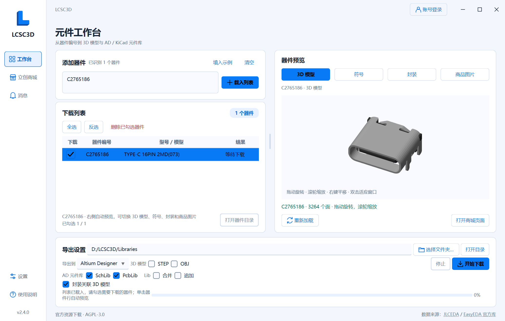

## 2.4.0 更新重点

- **封装内嵌 3D**：AD `.PcbLib` 内嵌 STEP；KiCad 9/10 将模型保存到封装文件，KiCad 8 使用库内相对路径引用外部 STEP。
- **批量生成带模型的封装**：单器件、分别合并、保留独立副本和 AD 追加均支持模型关联；不必另勾 STEP 下载。
- **保持模型原始尺寸**：修正 Type-C 的水平和高度基准换算，保留官方角度、偏移和原始 STEP 内容。
- **平滑下载进度**：查询、模型准备、处理和写库阶段推动进度；取消不再误显示 100%。
- **消息记录**：左侧新增“消息”，通知统一从右上角出现，新消息在上；支持历史查看、搜索、筛选与复制。
- **代码与诊断整理**：应用实现按职责分包，保留日志、更新、备份与失败恢复流程；636 项全量回归通过。

旧版变化见 [版本历史](docs/版本历史.md)。

## 开始使用

1. 从 [Releases](https://github.com/Travelerrrrrr/LCSC3D/releases/latest) 下载 `LCSC3D.exe`，在 Windows 10/11 x64 上运行。
2. 点击 **立创商城** 搜索元件，或登录后从 **账号收藏** 勾选并加入下载列表；也可输入 `C2040, C20197, C456013` 后点击 **载入列表**。
3. 单击器件行查看预览，勾选需要导出的器件，选择保存目录。
4. 在 **导出到** 中选择 **Altium Designer / KiCad**，勾选所需模型和元件库格式；需要汇总时启用 **Lib → 合并**，分别设置库名。
5. 点击 **开始下载**，完成后点击 **打开器件目录**。在 AD 中打开 SchLib / PcbLib；在 KiCad 库管理器中添加符号库文件和封装库目录。

**再次合并以本次勾选为准。** AD 和 KiCad 的普通导出、合并会在生成成功后覆盖同名库；KiCad 会替换整个同名 `.pretty` 目录，移除旧成员。需要保留的元件须一并勾选。AD 的 **追加** 模式用于向已有库增加元件，KiCad 暂不提供追加。

## 封装内嵌 3D 模型

勾选 AD **PcbLib** 或 KiCad **封装库**，保持 **封装关联 3D 模型** 开启，软件会取得所需官方 STEP 并写入封装。**无需另勾“STEP”下载，也无需在 EDA 中逐个手动关联模型。**

| 目标 | 模型保存方式 | 复制或搬迁 |
| --- | --- | --- |
| Altium Designer | STEP 内嵌到 `.PcbLib` | 模型随封装库文件保存 |
| KiCad 9 / 10 | STEP 内嵌到 `.kicad_mod` | 模型随封装文件保存，保留 `.pretty` 库结构 |
| KiCad 8 | `.pretty/LCSC3D.3dshapes/` 内的外部 STEP | 整体保留 `.pretty` 文件夹及其模型目录 |

以下是用户提供的 AD、KiCad 实测截图，展示导出后的 Type-C 三维效果。点击图片可查看原图。

| AD 内嵌模型示例一 | AD 内嵌模型示例二 |
| --- | --- |
| <a href="docs/images/2.4.0-release/ad-embedded-typec-user.png">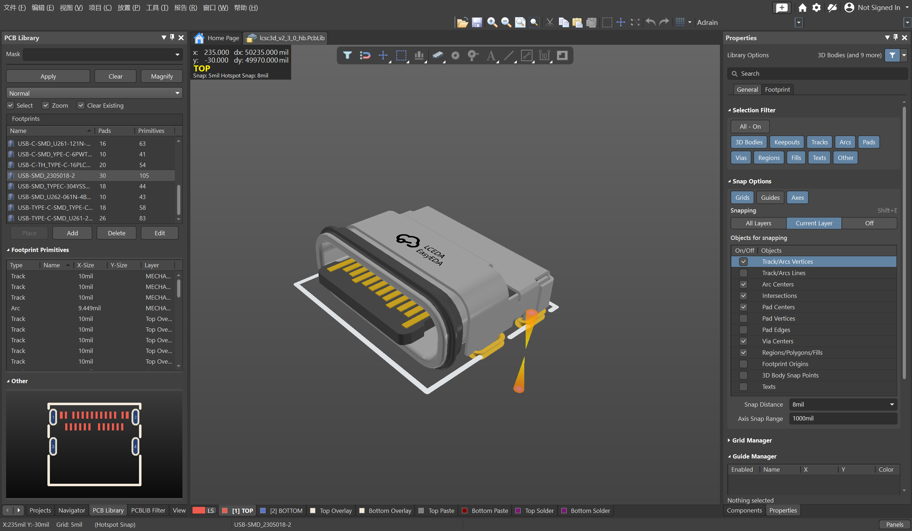</a> | <a href="docs/images/2.4.0-release/ad-embedded-typec-side-user.png">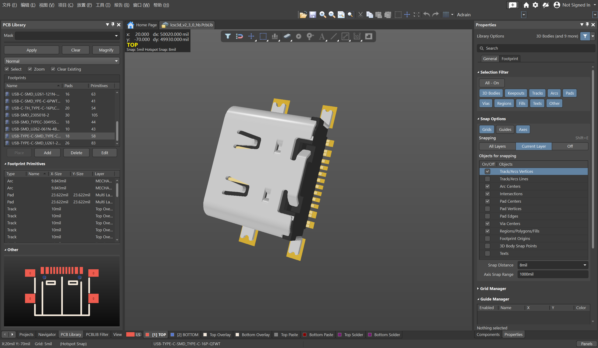</a> |

| KiCad PCB 三维视图 | KiCad 底面与焊盘视图 |
| --- | --- |
| <a href="docs/images/2.4.0-release/kicad-embedded-typec-top-user.png">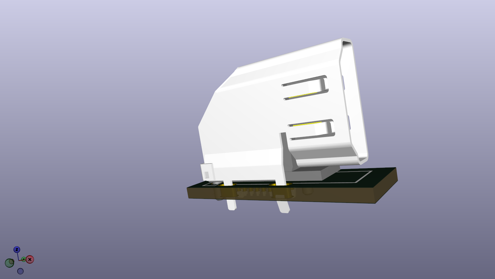</a> | <a href="docs/images/2.4.0-release/kicad-embedded-typec-bottom-user.png">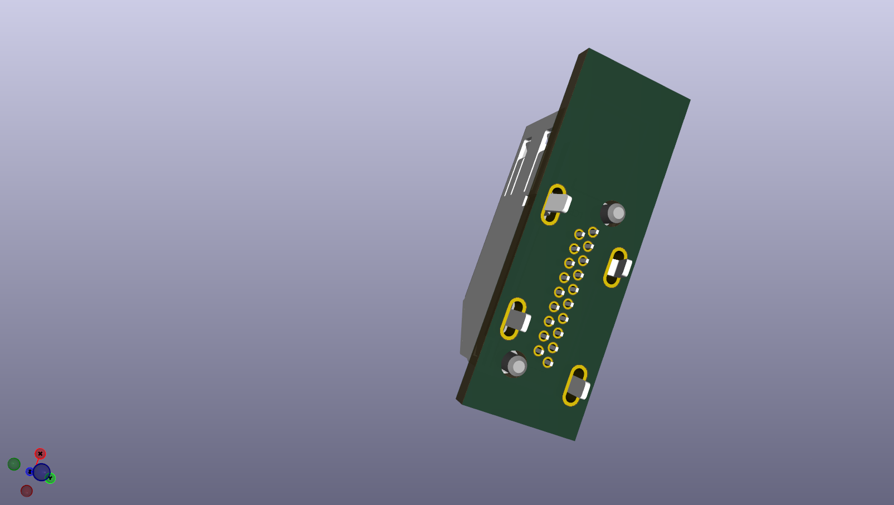</a> |

缺少 3D 模型时仍可导出可用的二维封装；模型关联失败会保留二维结果并说明原因。**商城有商品，不代表官方已提供符号、封装或 3D 资源。**具体操作与放置范围见 [使用说明](app/README.md#封装关联-3d-模型) 和 [模型放置说明](docs/3D模型放置.md)。

## 符号与封装导出

| 功能 | Altium Designer | KiCad 8+ |
| --- | --- | --- |
| 文件格式 | 原生 `.SchLib` / `.PcbLib` | `.kicad_sym` / `.pretty` 内的 `.kicad_mod` |
| 独立与合并 | 符号、封装分别控制合并与库名，可保留单器件副本 | 相同操作方式，共享封装自动复用 |
| 引脚电气类型 | 统一导出为 Passive | 默认跟随源数据，也可统一指定；不支持的类型为“未指定” |
| 符号风格 | 嘉立创 / AD，可在预览页切换并应用到导出 | 固定 KiCad 风格；矩形使用直角、实心主体背景填充 |
| 封装几何 | 焊盘、钻孔、槽孔、铜区、图形及原生过孔 | 焊盘、钻孔、槽孔、铜区和图形；过孔以无编号镀通孔保留 |
| 追加与工程 | 追加已有库、自定义工程目录与库名、导入 `.PrjPcb` | 暂不支持追加和工程自动注册 |

KiCad 添加封装库时，**库昵称应与导出库名一致**，例如 `LCSC3D`，以便符号找到对应封装。KiCad 封装中的过孔保留位置、孔径和铜环，网络归属需在 PCB 中确认。导出过程需要近似转换时，会在结果中提示。

两种目标均支持多单元符号、字符串引脚编号和常见贴片 / 通孔封装，并默认关联可用的 3D 模型。AD 暂不生成 IntLib。

具体操作见 [使用说明](app/README.md)。

## KiCad 导出效果

以下为用户提供的 KiCad 实测截图，展示导出的符号和封装。点击图片可查看原图。

| 集成电路符号 | MOS 管符号 |
| --- | --- |
| <a href="docs/images/2.3.0-release/kicad-symbol-ic-user.png"></a> | <a href="docs/images/2.3.0-release/kicad-symbol-mosfet-user.png"></a> |

| 带过孔的封装 | 自定义焊盘封装 |
| --- | --- |
| <a href="docs/images/2.3.0-release/kicad-footprint-vias-user.png"></a> | <a href="docs/images/2.3.0-release/kicad-footprint-custom-pads-user.png"></a> |

**带散热焊盘的封装**

<a href="docs/images/2.3.0-release/kicad-footprint-thermal-pad-user.png"></a>

## AD 导出效果

以下保留此前的 AD 实测截图，展示符号库、封装库和 PCB 工程中的库引用。更多符号、封装及三维示例可展开查看。

| AD 中的原理图库 | AD 中的 PCB 封装库 |
| --- | --- |
| <a href="docs/images/2.2.0/ad-symbol-user.png">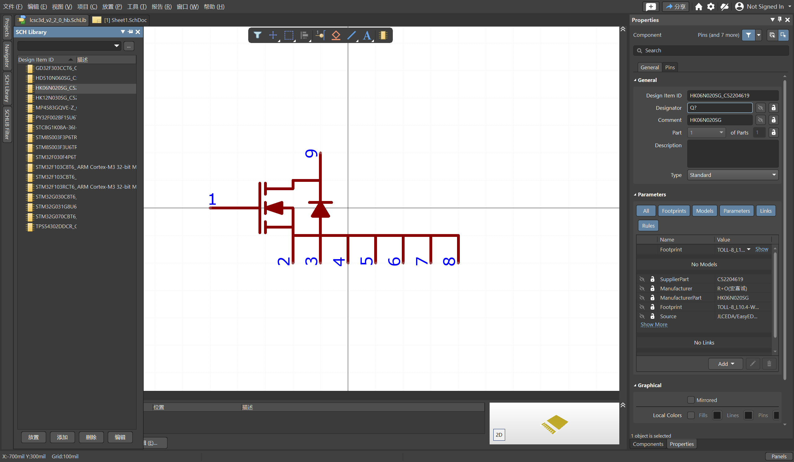</a> | <a href="docs/images/2.2.0/ad-footprint-user.png">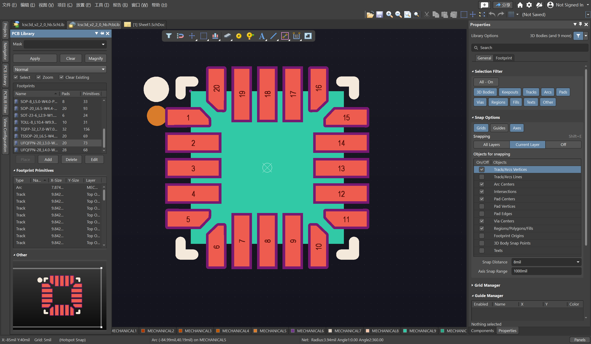</a> |

<a href="docs/images/2.2.0/ad-project-user.png">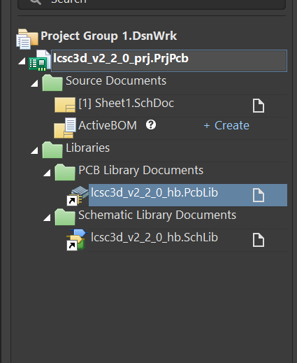</a>

<details>
<summary>更多既有 AD 实机示例：多单元符号、BGA、连接器和手动添加 STEP 后的三维效果</summary>

以下历史三维截图展示在 AD 中**另外添加 STEP 模型后**的效果，拍摄于本地开发版加入自动模型关联之前。

| 多单元原理图符号 | BGA 封装 |
| --- | --- |
| <a href="docs/images/screenshots/4.png">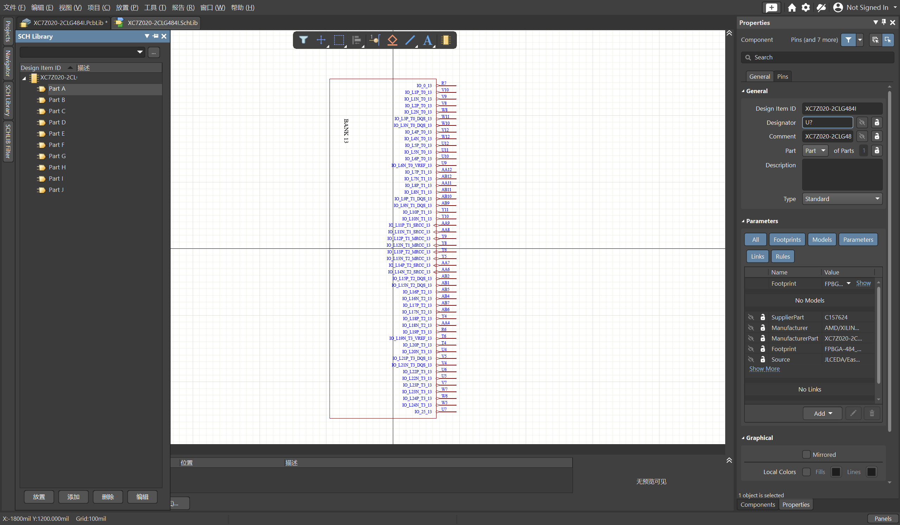</a> | <a href="docs/images/screenshots/5.png">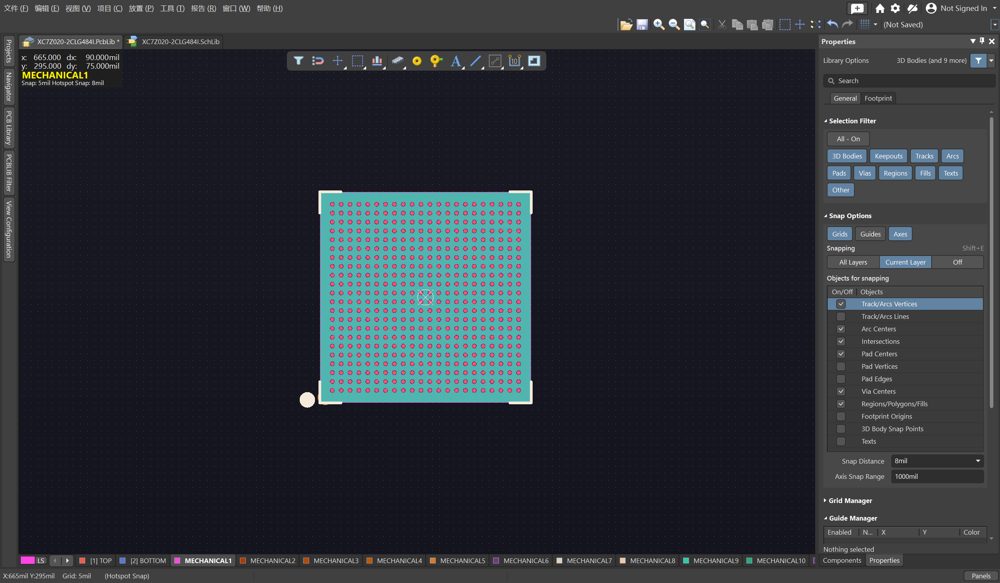</a> |

| 焊盘与铜区细节 | 异形焊盘示例 |
| --- | --- |
| <a href="docs/images/screenshots/6.png">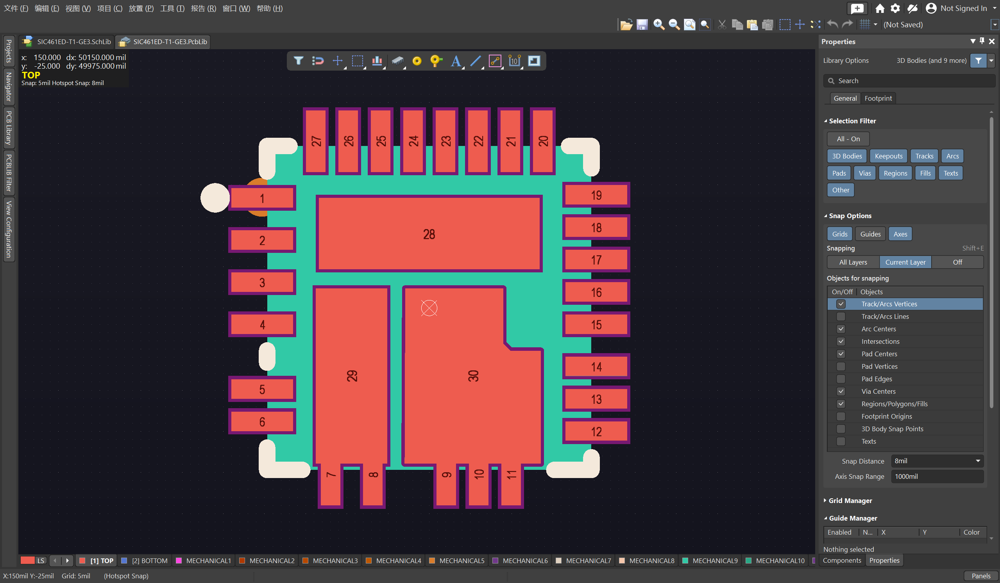</a> | <a href="docs/images/screenshots/7.png">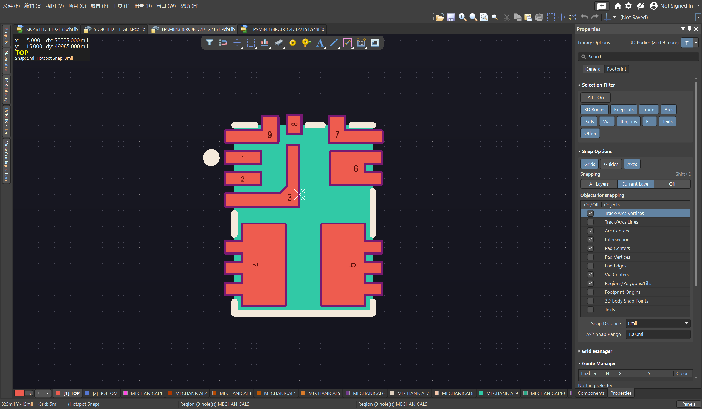</a> |

| 连接器二维封装 | 添加 STEP 后的 AD 三维视图 |
| --- | --- |
| <a href="docs/images/screenshots/8.png">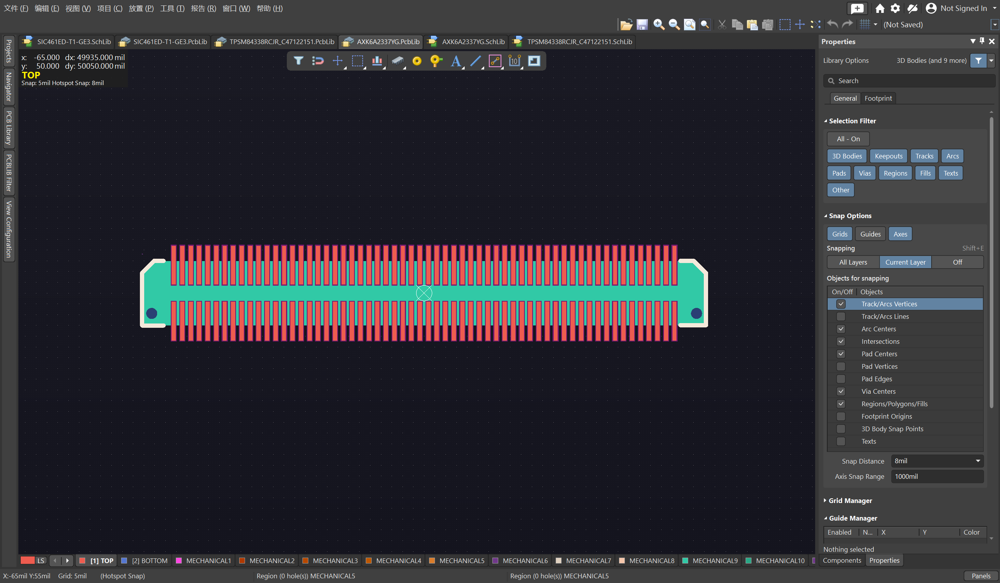</a> | <a href="docs/images/screenshots/9.png">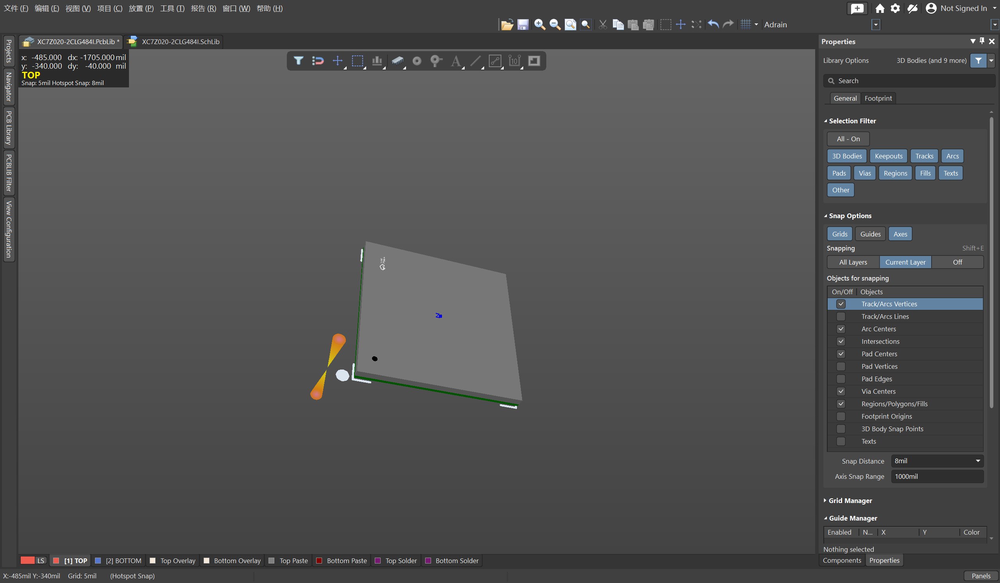</a> |

| 连接器三维视图 | 连接器另一侧视图 |
| --- | --- |
| <a href="docs/images/screenshots/10.png">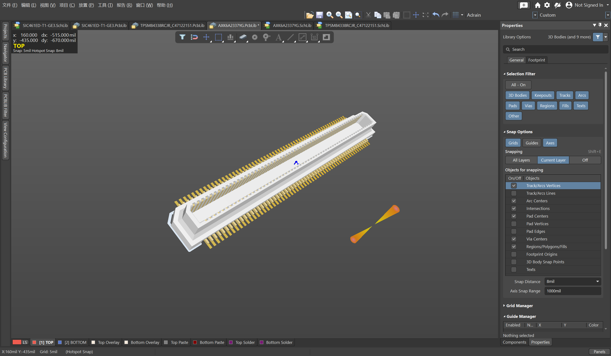</a> | <a href="docs/images/screenshots/11.png">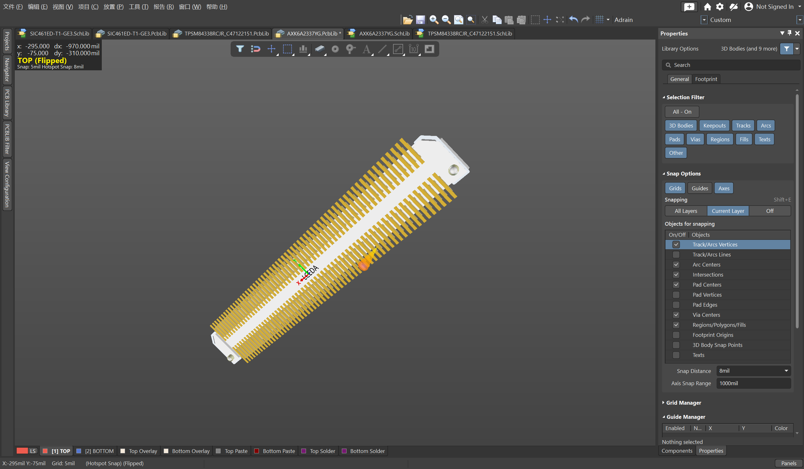</a> |

| Type-C 三维视图 | Type-C 底部视图 |
| --- | --- |
| <a href="docs/images/screenshots/12.png">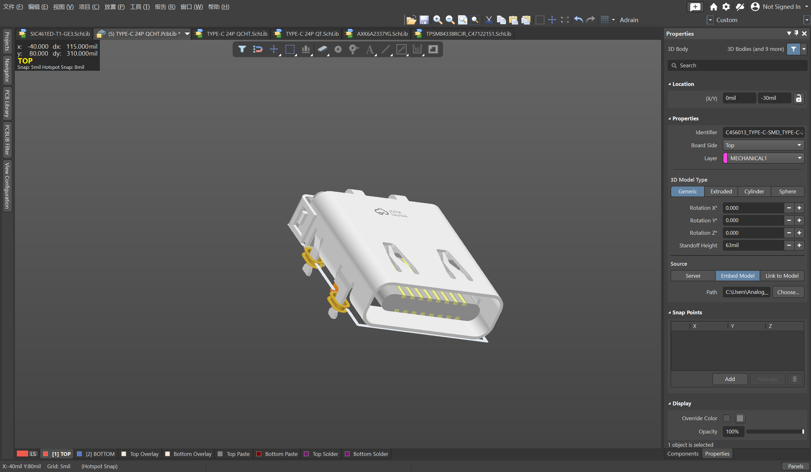</a> | <a href="docs/images/screenshots/13.png">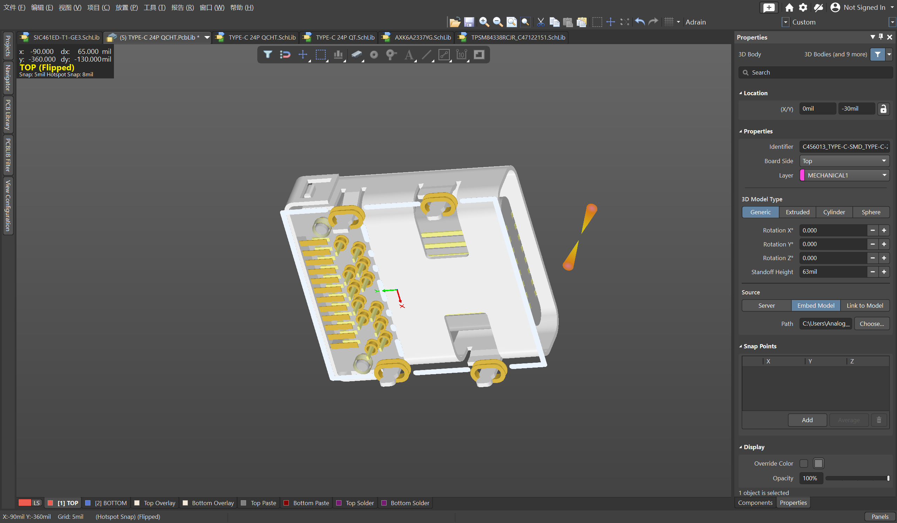</a> |

</details>

## 中间层与导出器架构

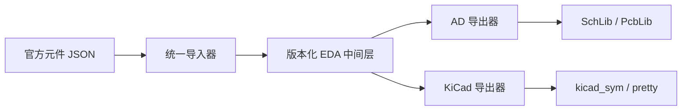

中间层集中记录符号与多单元、引脚名称和编号、连接方向与电气类型，以及图形、文字、图层、焊盘、钻孔、槽孔、过孔和 3D 来源关联。AD 与 KiCad 导出器读取同一份数据，再按各软件的格式和配置生成元件库。

中间层采用独立版本和兼容规则：新增可选字段提供默认值，保持已有字段含义，继续读取旧数据。无法可靠转换的关键几何会明确提示，不静默丢弃。后续适配其他 EDA 时，可以增加导出器并复用已有导入与元件信息；各软件的风格和库管理规则由对应导出器处理。

设计与兼容细节见 [EDA 中间层说明](docs/EDA中间层.md)。

## 选型、预览与批量下载

| 功能 | 使用方式 |
| --- | --- |
| 商城与收藏 | 按 C 编号、型号或关键词搜索；每页 20 项，跨页保留勾选。搜索与收藏列表显示缩略图，双击查看原图。 |
| 价格与资料 | 查看库存、独立选择价格梯度，阅读完整参数，打开数据手册和全部原图。 |
| 四类预览 | 在 3D 模型、符号、封装、商品图片间切换；支持缩放、平移和适应窗口。 |
| 批量下载 | STEP / OBJ 与所选目标的两种库格式可自由组合；逐器件显示进度与结果，支持停止和重试。 |
| 合并整理 | 复用相同封装，可保留独立器件；不保留独立副本时，模型集中在 `库名_3D` 文件夹。 |

没有 3D 模型的元件仍可导出可用的符号和封装；某一格式失败时保留其他成功资源。资源是否可用以官方数据和任务结果为准。

## 设置、日志与更新

**设置** 提供简体中文 / English、跟随系统 / 浅色 / 深色、配色、按钮文字颜色、字体和 10–24px 字号。English 使用 LCSC 国际商城，显示英文资料及美元价格；国际站登录与收藏通过 LCSC.com 网页管理，国内账号会话与国际站分别使用。

商城和更新可分别选择系统代理或直连。**日志与诊断** 可选择日志等级、打开目录、打包或清除日志；记录下载、AD / KiCad 转换、文件替换和失败恢复等步骤。诊断包不收集登录凭据，清除后继续记录和捕获崩溃。AD 追加与工程修改支持自动备份，可在 **设置 → 备份** 查看和恢复。

配置、会话、日志、缓存和更新数据统一存放在 `%LOCALAPPDATA%/LCSC3D/`。用户选择的模型和元件库导出目录独立设置。

启动后后台检查正式新版，也可在 **设置 → 关于与支持 → 检查更新** 手动查询。下载并通过 SHA-256 校验后，可选择 **下载并重启**；更新保留设置和已导出资源。Release 提供便携程序 `LCSC3D.exe`、完整源码 `LCSC3D.zip` 和校验文件 `SHA256SUMS.txt`。

## 使用范围

下载和在线预览需要联网，3D 预览需要支持 WebGL 的显卡驱动。已验证 KiCad 8 / 9 / 10；支持情况与本版验证范围见 [验证记录](docs/2.4.0验证记录.md)。

预览和导出用于辅助选型与设计，生产使用前仍需按数据手册核对引脚、电气类型、尺寸和封装。此前用旧版导出的引脚方向异常符号，需要重新导出。

## 源码运行与构建

开发环境为 Windows x64、Python 3.12。

```powershell
git clone https://github.com/Travelerrrrrr/LCSC3D.git
cd LCSC3D
python -m venv .venv
.\.venv\Scripts\python.exe -m pip install -r app/requirements-test.txt
.\.venv\Scripts\python.exe app/main.py
```

运行 `app/build.ps1` 完成测试与便携程序构建。开发和发行流程见 [贡献指南](CONTRIBUTING.md)。

## 许可证、数据来源与支持

项目代码采用 [AGPL-3.0-or-later](LICENSE)，依赖声明见 [第三方声明](app/licenses/THIRD-PARTY.md)。符号、封装和模型来自 [嘉立创EDA / JLCEDA 官方库](https://lceda.cn/) 与 [EasyEDA 官方库](https://easyeda.com/)；软件许可证不替代元件数据自身的版权与使用条件。

欢迎通过 [Issues](https://github.com/Travelerrrrrr/LCSC3D/issues) 反馈问题，附上 C 编号、版本、所选格式、错误提示与截图。也欢迎点 Star 或 [赞助支持](docs/sponsorship.md)。

## 鸣谢

感谢 [uPesy/easyeda2kicad.py](https://github.com/uPesy/easyeda2kicad.py) 为 EasyEDA / LCSC 元件到 KiCad 的转换提供思路和参考。
